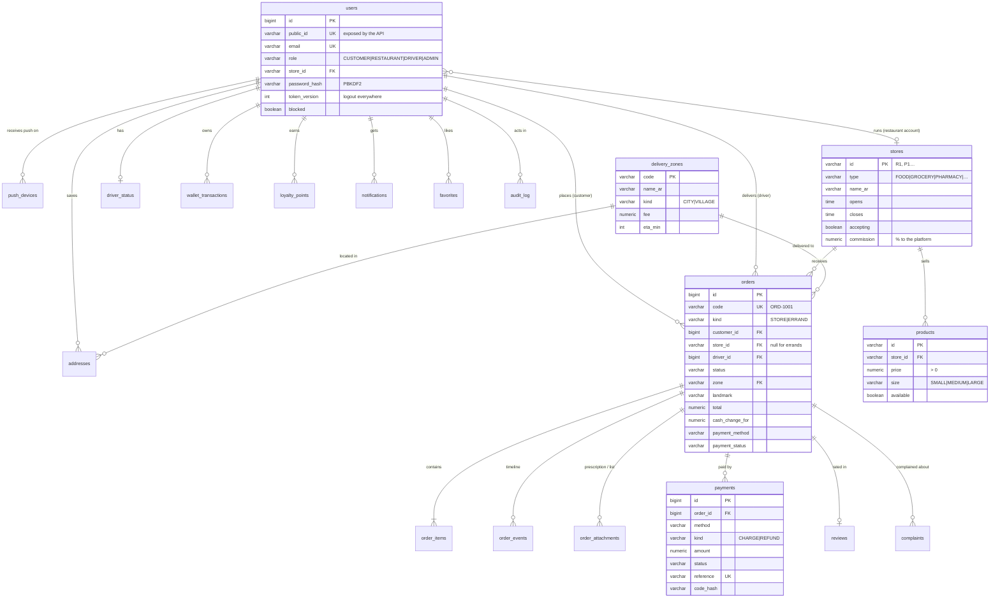
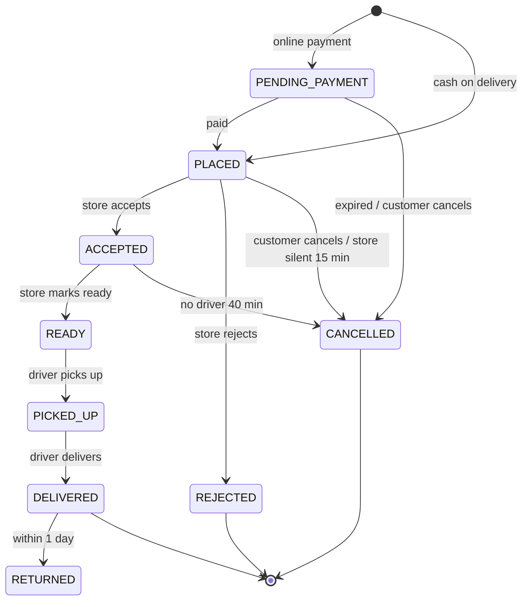

# VELOX — Database design

PostgreSQL 16 · migrations in [`database/migrations`](../../database/migrations) (Flyway, applied in order on start-up).
Each migration belongs to the module owner who maintains it.

| Migration | Module | Owner | Tables |
|---|---|---|---|
| `V1__accounts.sql` | Accounts & security | Nabeeh (@nabosallem-svg) | users, addresses, push_devices, login_attempts, audit_log |
| `V2__catalog.sql` | Catalogue | Hoda (@hodayasser511-stack) | stores, products, favorites |
| `V3__orders.sql` | Orders & delivery | Abdelrhman (@abdelrhman19122007) | delivery_zones, orders, order_items, order_attachments, order_events |
| `V4__payments.sql` | Payments & wallet | Fady (@fadyza15-collab) | payments, wallet_transactions, promo_codes, loyalty_points |
| `V5__operations.sql` | Drivers & support | Raheek (@Raheek25) | driver_status, reviews, complaints, notifications |
| `V6__seed.sql` | Starting data | Nabeeh (@nabosallem-svg) | delivery zone (Samannoud), promo codes |

## Entity–relationship diagram

## Order lifecycle (State pattern)

## Rules the database enforces itself (defence in depth)

The application validates everything, but these constraints stop bad data even if a bug or an injection gets past it
(verified on a fresh PostgreSQL — see the security report):

| Rule | Constraint |
|---|---|
| Only four roles exist | `users.role CHECK (…)` |
| Prices are positive, quantities 1–99 | `products.price > 0`, `order_items.qty BETWEEN 1 AND 99` |
| A store order always has a store; only errands may not | `orders CHECK (kind = 'ERRAND' OR store_id IS NOT NULL)` |
| Orders go only to known zones | `orders.zone → delivery_zones` foreign key |
| A payment reference is never reused | unique partial index `payments_reference` |
| Status / method values are a fixed list | `CHECK (… IN (…))` on every status column |
| Passwords and payment codes are never stored in clear | `password_hash` (PBKDF2), `payments.code_hash` |
| Order receipts never change after the menu does | item name and price copied into `order_items` |

## Data dictionary (main tables)

### users
| Column | Type | Notes |
|---|---|---|
| id | bigint PK | internal only — never sent to clients |
| public_id | varchar(20) unique | random id used by the API (prevents guessing other users' ids) |
| email | varchar(120) unique | login |
| role | varchar(12) | CUSTOMER / RESTAURANT / DRIVER / ADMIN |
| store_id | varchar(10) FK | the store a RESTAURANT account runs |
| password_hash | varchar(200) | `pbkdf2$210000$salt$hash` |
| token_version | int | raising it signs the account out everywhere |
| blocked | boolean | blocked accounts can't sign in |

### orders
| Column | Type | Notes |
|---|---|---|
| code | varchar(20) unique | ORD-1001, shown to people |
| kind | STORE / ERRAND | errand = "bring me anything" from any shop |
| status | see lifecycle above | changed only through order_events |
| zone | FK delivery_zones | fixed fee per area / village |
| landmark | varchar(150) | how places are found in Samannoud |
| cash_change_for | numeric | the note the customer will pay with, so the driver brings change |
| payment_method / payment_status | | current summary; every attempt is in `payments` |
| scheduled_for | timestamptz | e.g. iftar orders in Ramadan |

### payments
| Column | Type | Notes |
|---|---|---|
| kind | CHARGE / REFUND | refunds are rows too — full money trail |
| reference | varchar(40) unique | Fawry reference or wallet transaction id |
| code_hash | varchar(200) | Vodafone Cash confirmation code, hashed |
| attempts | int | wrong codes (max 5) |
| expires_at | timestamptz | 10 min wallet / 60 min Fawry |
