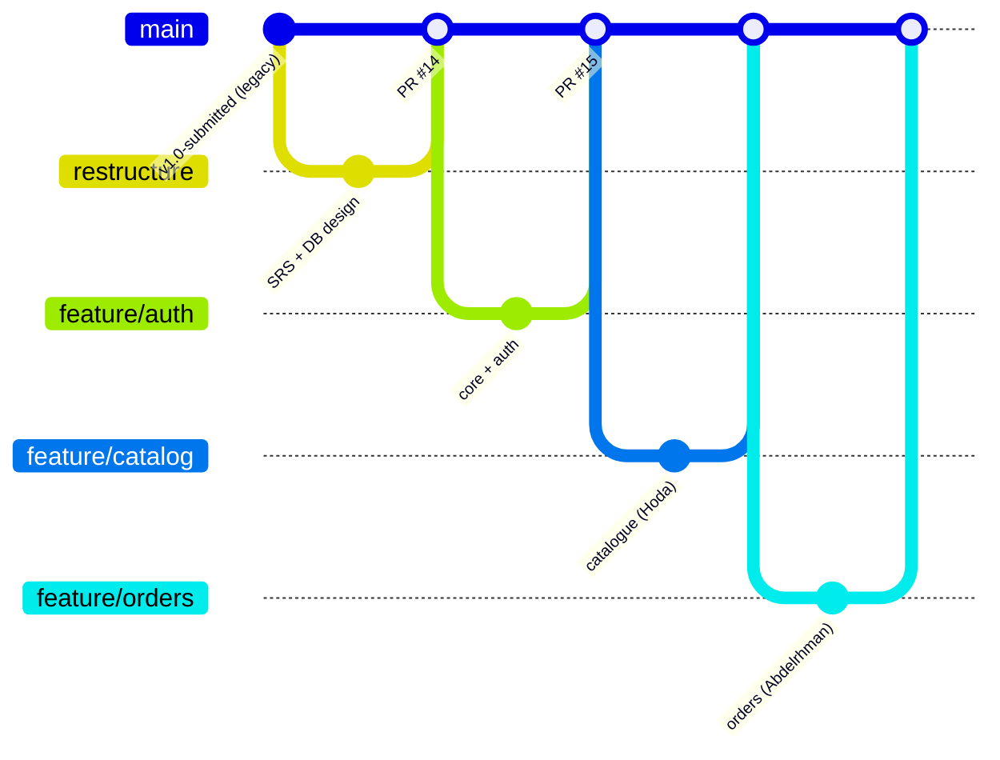
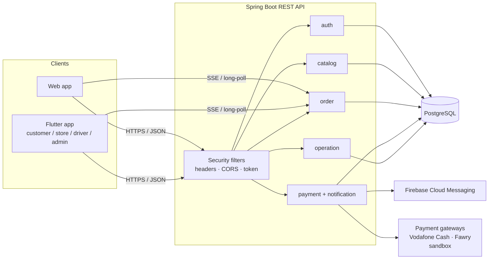
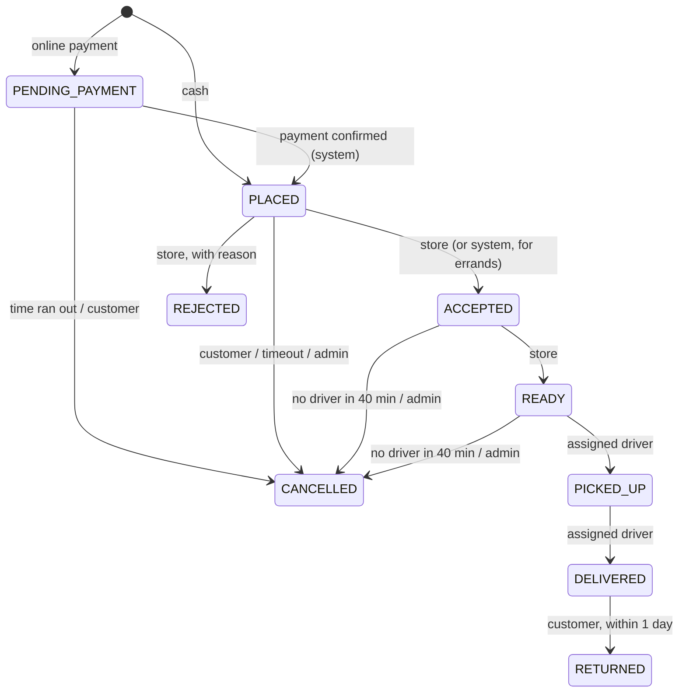

# VELOX — Final Project Report
### A secure local delivery platform for Samannoud

| | |
|---|---|
| Programme | Digital Egypt Pioneers Initiative (DEPI) — Penetration Testing track |
| Project | VELOX v2 — web + mobile delivery platform with a Java backend |
| Repository | https://github.com/abdelrhman19122007/VELOX |
| Report version | 1.0 draft — October 2026 |
| Related documents | [SRS](../SRS.md) · [Database design](../database/ERD.md) · [Security test reports](../../security/) · [Contributing guide](../../CONTRIBUTING.md) |

**Team**

| Member | GitHub | Module | Other responsibilities |
|---|---|---|---|
| Nabeeh Mohamed (lead) | @nabosallem-svg | Accounts & security core | architecture, SRS, database, CI, integration, reviews |
| Hoda | @hodayasser511-stack | Catalogue | ERD, Selenium UI tests, catalogue pentest |
| Abdelrhman | @abdelrhman19122007 | Orders & delivery | delivery zones, Postman/Newman, user interface, orders pentest |
| Fady | @fadyza15-collab | Payments, wallet & notifications | JMeter performance tests, payments pentest |
| Raheek | @Raheek25 | Operations (store, driver, admin) | test plan, Flutter tests, privilege-escalation pentest |

> **Status legend used in this report:** ✅ done and verified · 🟡 in progress · ⬜ planned.
> Sections marked _[to fill]_ are completed by the module owner after their manual tests.

---

## Abstract
VELOX is a delivery platform for Samannoud (Gharbia, Egypt) and its villages. Customers order from local
restaurants, groceries and pharmacies — or ask a driver to "bring anything" — and follow the order live; stores
and drivers work from their own dashboards; payment is cash, Vodafone Cash, Fawry or an in-app wallet.

Because the team follows the **Penetration Testing** track, the project was designed *security-first*. Every
requirement is mapped to the OWASP Top 10 (2021). Every module ships with automated attack tests and a manual
penetration-test plan written by its owner.

The backend is a Java 17 / Spring Boot REST API on PostgreSQL, organised as five modules with a clean layered
architecture and classic design patterns (State, Strategy, Observer). It is covered by **92 automated tests**
that run against a real PostgreSQL database, with **86 % instruction coverage**. Development already found and
fixed a real high-severity vulnerability: unlimited guessing of the mobile-wallet confirmation code.

---

## 1. Introduction

### 1.1 Problem
- **Poor coverage by the big apps.** National delivery apps cover Samannoud poorly and list very few local shops.
- **Orders by phone.** Most orders are taken by phone or WhatsApp, with no menu, no fixed prices and no tracking.
- **Addresses by landmark.** Addresses are described by landmarks ("next to the big mosque") and are often misunderstood.
- **No way for small shops to sell online,** while many young people with motorbikes or tuk-tuks are looking for work.

### 1.2 Objectives
1. One platform for customers, stores, drivers and the administrator, on the web and on Android (Google Play).
2. Fit the local reality:
   - delivery fees per village;
   - landmark addresses;
   - "bring me anything" errands;
   - tuk-tuks for gas cylinders;
   - cash on delivery with change;
   - scheduled iftar orders.
3. **Security as a primary requirement.** Server-side enforcement of every rule, protection against the OWASP
   Top 10, and evidence through automated and manual penetration tests.
4. **Clean, maintainable Java code.** Layered modules, design patterns and high test coverage.
5. **Real team collaboration on GitHub.** Every member owns and uploads a module, reviewed through pull requests.

### 1.3 Scope
- **In scope:** accounts, catalogue, ordering, delivery zones, live tracking, payments (cash / Vodafone Cash /
  Fawry / wallet), promo codes, loyalty points, notifications, the store / driver / admin dashboards, reviews,
  complaints, and security controls.
- **Out of scope for v2:** card payments, iOS, cities outside the Samannoud area.

Full requirements are in the [SRS](../SRS.md), which follows IEEE 830 / ISO/IEC/IEEE 29148.

---

## 2. Methodology and team workflow

### 2.1 Process
- **Iterative development.** Short iterations, one module at a time, in dependency order:
  core → catalogue → orders → payments → operations.
- **Documents first.** The SRS and the database design were written and merged before any code.
- **Definition of done for a module:**
  - code;
  - automated tests, including attack tests;
  - a module guide;
  - a penetration-test plan;
  - green CI;
  - a reviewed pull request.

### 2.2 Git workflow

- **One branch per module:** `feature/<module>`. `main` is always releasable.
- **Pull requests only into `main`.** A PR needs a review from the lead and a green CI run, and is merged with
  a merge commit so each member's own commits stay visible.
- **Legacy code.** The first version (v1, a Java console + web prototype) is kept under `legacy/` and tagged
  `v1.0-submitted`.

### 2.3 Tools
| Purpose | Tool |
|---|---|
| Language / framework | Java 17, Spring Boot 3.3, Maven |
| Database | PostgreSQL 16, Flyway migrations |
| Tests | JUnit 5, Spring Boot Test, Testcontainers, JaCoCo |
| CI | GitHub Actions |
| Security testing | Burp Suite Community, OWASP ZAP, curl; planned: OWASP Dependency-Check, SpotBugs |
| API / UI / performance testing | Postman/Newman, Selenium, Apache JMeter (planned per SRS §8) |
| Mobile | Flutter (Android) |
| Containers | Docker, docker-compose |

---

## 3. Requirements summary
The SRS defines **56 functional requirements** in five groups and **13 security requirements**.

| Group | Examples | Owner |
|---|---|---|
| FR-AUTH | sign-up/in, brute-force lockout, password change/reset, sign out everywhere, addresses, admin user management | Nabeeh |
| FR-CAT | stores by type, opening hours, menus with sections and sizes, search, favourites, image upload | Hoda |
| FR-ORD | server-side pricing, zones, errands, scheduled orders, lifecycle, cancel/return, live updates | Abdelrhman |
| FR-PAY | Vodafone Cash, Fawry, wallet, refunds, promo codes, loyalty, notifications | Fady |
| FR-OPS | store / driver / admin dashboards, reviews, complaints | Raheek |

The non-functional requirements cover:
- performance: p95 < 500 ms at 100 users;
- reliability: no lost orders, automatic reconnection;
- usability: Arabic RTL by default;
- maintainability: layered code, patterns, ≥ 70 % coverage.

---

## 4. System design

### 4.1 Architecture


- **One backend for both clients.** The backend is the single source of truth, and the web and mobile apps are
  thin clients of the same API.
- **Live updates.** Order changes reach open apps through Server-Sent Events, with an automatic long-polling
  fallback for networks and tunnels that cut SSE.

### 4.2 Module structure (clean architecture)
Every module has the same layers. Controllers contain no business logic, and SQL lives only in repositories.

```
com.velox.<module>/
├── controller/   HTTP: validation, status codes
├── service/      business rules, authorisation, transactions
├── repository/   SQL (JdbcTemplate, parameterised queries only)
├── domain/       records and enums (Order, OrderStatus, Store…)
├── dto/          request / response shapes (input validation annotations)
└── MODULE_GUIDE.md
```

**Dependencies between modules** go one way:
- payments and operations depend on orders, which depends on the catalogue and accounts.
- Orders never import payments. Payments plugs into orders through small interfaces in `order/spi`, explained
  in §4.4.

### 4.3 Database
- **21 tables** in 6 Flyway migrations (`database/migrations/V1…V6`), with integrity enforced in the database
  itself: CHECK constraints on statuses, prices > 0, quantities 1–99, ratings 1–5, and a store order must have a store.
- **Random public ids.** Users are identified to clients by a random public id, never by the sequential primary key.
- **Order codes.** Order codes (ORD-1001…) come from a sequence and are never trusted on their own: every access
  also checks ownership.

Full diagram and table descriptions: [ERD.md](../database/ERD.md).

| Migration | Tables |
|---|---|
| V1 accounts | users, addresses, push_devices, login_attempts, audit_log |
| V2 catalogue | stores, products, favorites |
| V3 orders | delivery_zones, orders, order_items, order_attachments, order_events |
| V4 payments | payments, wallet_transactions, promo_codes, loyalty_points |
| V5 operations | driver_status, reviews, complaints, notifications |
| V6 seed | Samannoud zone, starter promo codes |

### 4.4 Design patterns
| Pattern | Where | Why |
|---|---|---|
| **State** | `OrderStatus` | Each status lists the statuses it may move to and *which role* may make the move. `OrderLifecycle` is the only code that changes a status, so a customer can never accept their own order and no one can skip a step. |
| **Strategy** | `DiscountPolicy`, `PaymentStarter`, `PaymentGateway` | Each payment method and promo type is its own class. A real Fawry / Vodafone Cash gateway replaces the sandbox one without touching other code. |
| **Observer** | `OrderChanged` event → `OrderLiveListener`, `RefundListener`, `NotificationService`, `OfferListener` | The order module announces a change; live updates, refunds, notifications and driver offers react on their own. Refunds run *inside* the same transaction (all or nothing), while notifications run *after commit*, so nobody is told about a change that was rolled back. |
| **Factory** | `StoreType` / id prefixes | Store and product ids are generated per type (R1, P1, G1…). |
| **Repository / Facade / Adapter** | repositories; `DriverService.take`; `PushService` | Isolate SQL; one call hides the multi-step "take order" rules; adapt domain events to the Firebase HTTP v1 API. |

### 4.5 Order lifecycle

- **Automatic timeouts:**
  - a store that doesn't answer in 15 minutes;
  - no driver within 40 minutes;
  - an unpaid online order after 10 minutes (Vodafone Cash) or 60 minutes (Fawry).
- **Money follows the status.** Paid orders that are rejected or cancelled are refunded to the wallet; a returned
  order refunds the items' value.

### 4.6 API
- **71 REST endpoints**, grouped by role:
  - public catalogue;
  - `/api/auth`;
  - `/api/me/*`;
  - `/api/orders/*`;
  - `/api/restaurant/*`;
  - `/api/driver/*`;
  - `/api/admin/*`.
- **Errors use one JSON format** `{status, code, message, details}`, with stable codes such as `ORDER_NOT_FOUND`,
  `WRONG_CODE` and `ALREADY_TAKEN` that the apps translate. A stack trace is never returned.
- **Endpoint lists** are in each module's `MODULE_GUIDE.md`, and the attack scope of each endpoint is in `security/<module>.md`.

---

## 5. Implementation

### 5.1 Modules
| Module | Main features | Status |
|---|---|---|
| **Core & accounts** | PBKDF2 passwords, signed tokens with revocation, login lockout, addresses (max 10), admin block / temporary password, audit log, security headers, CORS allow-list, admin bootstrapped from environment variables | ✅ merged |
| **Catalogue** | 6 store types, opening hours (incl. past midnight), menus with sections and sizes, search (LIKE-escaped), favourites, safe image upload | ✅ ready, upload pending |
| **Orders** | server-side pricing, village fees, +10 EGP tuk-tuk surcharge for large items, errands, cash change, scheduled orders, lifecycle, cancel / return, timeouts, live updates | ✅ ready, upload pending |
| **Payments** | Vodafone Cash (6-digit code, 5 tries), Fawry (9-digit reference), wallet with row locking, refunds, promo codes (percent / fixed / free delivery), loyalty points, inbox + push notifications | ✅ ready, upload pending |
| **Operations** | store accept / reject / ready and daily numbers, driver online / offers / take / pick up / deliver / location / earnings, one order per driver, vehicle check, admin orders / cancel / stats, reviews, complaints with personal compensation codes | ✅ ready, upload pending |
| **Web interface** | customer, store and admin pages | 🟡 design in progress (Abdelrhman) |
| **Flutter app** | one app, screens by role, Arabic RTL | 🟡 v1 app exists; to be connected to the v2 API |

### 5.2 Local features
- **Landmark field** on every address and order.
- **"Bring me anything" errands,** handled by drivers directly.
- **Gas cylinders and cartons** are marked LARGE: they add a surcharge and are offered only to tuk-tuk or car drivers.
- **"I'll pay with 200"** tells the driver how much change to bring.
- **Scheduled orders** for iftar in Ramadan.
- **Arabic-first notifications,** with English for devices set to English.

### 5.3 Configuration and secrets
- **All configuration comes from environment variables:** database, token secret, CORS origins, admin account.
- **No secret is committed.** The token secret has no default in production. The Firebase service account is
  read from a git-ignored folder, and the sandbox payment endpoints are switched off with `velox.payments.sandbox=false`.

---

## 6. Security (Penetration Testing track)

### 6.1 Approach
1. **Threat-driven requirements.** Each SRS security requirement is tied to an OWASP Top 10 (2021) category (§6.2).
2. **Secure by design.** Every rule is enforced on the server: the apps are untrusted, and prices, totals,
   statuses and ownership are decided only by the backend.
3. **Automated attack tests.** Every module has integration tests that *perform* the attacks over HTTP against
   the real application and database: IDOR, tampering, replay, brute force, races, XSS payloads and privilege escalation.
4. **Manual penetration tests.** Each owner tests their module with Burp Suite and ZAP using a written plan
   (`security/<module>.md`) and records evidence.

### 6.2 Controls mapped to OWASP Top 10 (2021)
| OWASP | Control in VELOX | Evidence |
|---|---|---|
| **A01 Broken Access Control** | Role checks in every service (`require(Role…)`); ownership checks on every order, payment, address, device, review and complaint; someone else's resource answers **404**, not 403, so its existence isn't revealed; random public user ids | IDOR and privilege tests in every module |
| **A02 Cryptographic Failures** | PBKDF2-HMAC-SHA256, 210 000 iterations with random salt; payment codes hashed; HMAC-SHA256 tokens; HSTS in production | `PasswordHasherTest`, `TokenServiceTest` |
| **A03 Injection** | Only parameterised SQL; LIKE wildcards escaped in search; status filters parsed to enums; `<` and `>` refused in free text (stored-XSS prevention) | SQLi / XSS cases in catalogue, orders, operations tests |
| **A04 Insecure Design** | Server-side prices; state machine; conditional updates against races (`WHERE status = …`, `WHERE driver_id IS NULL`); wallet row lock; one order per driver; refunds in the same transaction | price-tampering, replay, race and lifecycle tests |
| **A05 Security Misconfiguration** | No default credentials; generic errors; CORS allow-list; security headers (`nosniff`, `DENY` framing, referrer and permissions policy, `no-store` for API responses) | `AuthApiTest`, headers check |
| **A06 Vulnerable Components** | Current Spring Boot 3.3; dependency scanning in CI | ⬜ OWASP Dependency-Check job planned |
| **A07 Authentication Failures** | Lockout after 5 failures per email / 30 per IP in 10 minutes; token revocation (sign out everywhere, password change, block); 5-try limit on payment codes; identical error for every wrong promo code | `AuthApiTest`, `OnlinePaymentApiTest` |
| **A08 Integrity Failures** | Uploads checked by magic bytes, 2 MB limit, random file names, never executed | `UploadApiTest` |
| **A09 Logging & Monitoring** | `audit_log` for admin actions, blocks, password resets, order cancels, complaint closing; failed logins recorded | audit assertions in tests |
| **A10 SSRF** | The server calls only fixed hosts (Google OAuth / FCM); no user-supplied URLs are fetched | code review |

### 6.3 Automated attack tests (examples)
| Attack | Test | Result |
|---|---|---|
| Price tampering (send `total: 1`) | `OrderApiTest` | ✅ ignored, server price used |
| Read / cancel another customer's order | `OrderApiTest` | ✅ 404 |
| Store accepts another store's order | `OrderLifecycleTest`, `RestaurantOrderApiTest` | ✅ 404 |
| Skip lifecycle steps | `OrderStatusTest`, `DriverApiTest` | ✅ BAD_STATUS |
| Brute-force the Vodafone Cash code | `OnlinePaymentApiTest` | ✅ locked after 5 (after the fix in §6.4) |
| Pay the same order twice (replay) | `OnlinePaymentApiTest` | ✅ PAYMENT_CLOSED |
| Pay after the deadline | `OnlinePaymentApiTest` | ✅ PAYMENT_EXPIRED, order cancelled |
| Promo reuse / enumeration | `WalletAndPromoApiTest` | ✅ same INVALID_PROMO for every failure |
| Two drivers take one order | `DriverApiTest` | ✅ ALREADY_TAKEN |
| Customer / driver on admin or store endpoints | operations tests | ✅ 403 |
| Double compensation for a complaint | `AdminAndFeedbackApiTest` | ✅ COMPLAINT_CLOSED |
| Stored XSS in reviews, complaints, reasons | operations tests | ✅ 400 |
| Malicious file upload (script renamed .jpg) | `UploadApiTest` | ✅ refused |
| Login brute force | `AuthApiTest` | ✅ locked |

### 6.4 Vulnerabilities found during development
| # | Finding | Severity | Root cause | Fix | Regression test |
|---|---|---|---|---|---|
| V-01 | **Unlimited guessing of the Vodafone Cash confirmation code.** The 5-attempt limit never triggered, so an attacker could try all 1 000 000 codes. | **High** (CVSS 3.1 ≈ 7.5: AV:N/AC:L/PR:L/UI:N/S:U/C:N/I:H/A:N) | The wrong-code exception was thrown inside a `@Transactional` method, so the attempt counter's update was rolled back with it. | `@Transactional(noRollbackFor = ApiException.class)` on `PaymentService.confirmWallet` | `fiveWrongCodesClosesThePayment` |
| V-02 | The response to a wallet-paid order still showed `PENDING_PAYMENT` | Low (integrity of displayed data) | View built before the payment step updated the order | Re-read the order after the payment starts | `walletPaysOnlyWhatItHas` |

Lesson: **framework behaviour such as transaction rollback can silently disable a security control.** That is
why each control must be proven by an attack test, not only reviewed.

### 6.5 Manual penetration test results _[to fill]_
Each owner runs the manual cases in their plan and fills in this table, adding screenshots under `security/evidence/<module>/`.

| Module | Plan | Cases | Automated | Manual | Findings |
|---|---|---|---|---|---|
| Accounts | `security/README.md` | — | ✅ | _[to fill]_ | _[to fill]_ |
| Catalogue | [catalog.md](../../security/catalog.md) | 13 | most | _[to fill]_ | _[to fill]_ |
| Orders | [orders.md](../../security/orders.md) | 15 | 12 | _[to fill]_ | _[to fill]_ |
| Payments | [payments.md](../../security/payments.md) | 17 | 12 | _[to fill]_ | V-01, V-02 (fixed) |
| Operations | [operations.md](../../security/operations.md) | 18 | 15 | _[to fill]_ | _[to fill]_ |

---

## 7. Testing

### 7.1 Strategy
| Level | Tool | Status |
|---|---|---|
| Unit | JUnit 5 (state machine, opening hours, hashing, tokens) | ✅ |
| Integration / API | Spring Boot Test + **Testcontainers PostgreSQL**: the real app over HTTP, on the real schema and migrations | ✅ |
| Security | attack tests (above) + manual Burp / ZAP | ✅ automated / 🟡 manual |
| API collection | Postman / Newman | ⬜ (Abdelrhman) |
| UI / E2E | Selenium | ⬜ (Hoda), after the web UI |
| Mobile | Flutter widget / integration tests | ⬜ (Raheek) |
| Performance | Apache JMeter, 100 users, p95 < 500 ms | ⬜ (Fady) |

**Why Testcontainers:** tests run on the same database engine, constraints and migrations as production. That
is what makes the race-condition and constraint tests meaningful, which an in-memory database would not be.

### 7.2 Results (backend, October 2026)
**92 tests, 0 failures. Instruction coverage 86 %** (JaCoCo). The SRS target is ≥ 70 %.

| Module | Test classes | Tests | Coverage |
|---|---|---|---|
| Accounts & security core | AuthApiTest, AccountApiTest, AdminUserApiTest, TokenServiceTest, PasswordHasherTest | 23 | auth 89 %, security 93 % |
| Catalogue | CatalogUnitTest, StoreApiTest, SearchAndFavoritesApiTest, UploadApiTest | 19 | 82 % |
| Orders | OrderStatusTest, OrderApiTest, OrderLifecycleTest | 16 | 88 % |
| Payments & notifications | OnlinePaymentApiTest, WalletAndPromoApiTest, NotificationApiTest | 18 | payment 95 %, notification 56 %* |
| Operations | RestaurantOrderApiTest, DriverApiTest, AdminAndFeedbackApiTest | 16 | 95 % |
| **Total** | **18 classes** | **92** | **86 %** |

\* Push delivery to Firebase isn't exercised in CI: there is no Firebase project in the test environment, and
we don't call external services from tests. The inbox and device registration are fully tested.

### 7.3 Continuous integration
- **Every push and pull request runs the full suite on GitHub Actions** (`.github/workflows/backend.yml`):
  build, all tests with PostgreSQL in Docker, then upload the coverage report.
- **A red build blocks the merge.**
- **Planned additions:** OWASP Dependency-Check and SpotBugs jobs.

---

## 8. Deployment
- **Development:** `docker compose up -d` (PostgreSQL), then `./mvnw spring-boot:run`, as described in the README.
- **Demo:** the backend has been served from a team PC through a Cloudflare tunnel. The apps find the current
  address automatically and reconnect if the tunnel drops.
- **Production (planned):** a container host with managed PostgreSQL and HTTPS, before the Google Play release.

**Google Play** ⬜. The release needs:
- a developer account (one-time fee);
- a closed test with at least 12 testers for 14 days;
- a privacy policy (Egyptian Law 151/2020: phone and address are shown only to the order's parties).

---

## 9. Challenges and solutions
| Challenge | Solution |
|---|---|
| One shared repository, five contributors, one week | Module boundaries designed so each module is a separate folder, branch and PR. Upload order follows dependencies, and CI verifies each step. |
| Keeping each member's contribution visible | Each member uploads their own module from their own account; PRs are merged with merge commits. |
| Payments without a merchant contract | Sandbox gateways that behave like the real ones (code by SMS, reference number, expiry), behind a `PaymentGateway` interface. |
| Free hosting limits (cards required, no Docker) | Local server published through a Cloudflare tunnel, with automatic rediscovery and reconnection. |
| Live updates cut by proxies and tunnels | SSE with an automatic long-polling fallback. |
| Docker Desktop API change broke Testcontainers | Pinned the Docker API version in the test configuration and upgraded Testcontainers. |
| A security control silently disabled by a framework (V-01) | Found by an attack test, fixed, and kept as a regression test. |

## 10. Limitations and future work
- **Interfaces.** Finish the web interface and connect the Flutter app to the v2 API.
- **Real payment gateways.** Integrate them after a merchant contract; card payments.
- **Security scanning in CI:** Dependency-Check, SpotBugs, and a ZAP baseline scan.
- **Remaining test types:** performance tests (JMeter), Selenium and Flutter tests, Newman collection.
- **Production hosting** with backups (NFR-REL-03) and monitoring.
- **Smarter dispatch:** offers to the nearest drivers first.
- **Ratings shown to drivers;** more villages, then other towns.

## 11. Conclusion
VELOX v2 delivers a complete, tested backend for a real local need. It is built the way a penetration tester
would want to attack it: no client is trusted, every rule is enforced and proven on the server, and every module
comes with its own attack plan.

The project also shows how a five-person team can share one repository cleanly, with clear module ownership,
reviewed pull requests and automated checks. The remaining work — the interfaces, the manual pentest evidence,
the performance tests and the Play Store release — is planned and assigned.

---

## Appendix A — Repository map
```
VELOX/
├── backend/            Java 17 / Spring Boot API (modules under src/main/java/com/velox)
├── database/migrations Flyway SQL (V1–V6)
├── docs/               SRS, ERD, this report
├── security/           penetration-test plans and evidence per module
├── tests/              API / UI / performance test assets
├── legacy/             v1 prototype (tag v1.0-submitted)
├── .github/workflows/  CI
└── docker-compose.yml  local PostgreSQL
```

## Appendix B — How to run the tests
```bash
docker compose up -d          # not needed for tests: Testcontainers starts its own PostgreSQL
cd backend
./mvnw verify                 # all tests + coverage report in target/site/jacoco/index.html
```

## Appendix C — References
- IEEE Std 830-1998; ISO/IEC/IEEE 29148:2018
- OWASP Top 10 (2021); OWASP ASVS 4.0; OWASP Mobile Top 10 (2024); OWASP Web Security Testing Guide
- Spring Boot 3.3 reference documentation; Testcontainers documentation
- Firebase Cloud Messaging HTTP v1 API
- Egyptian Personal Data Protection Law No. 151 of 2020
